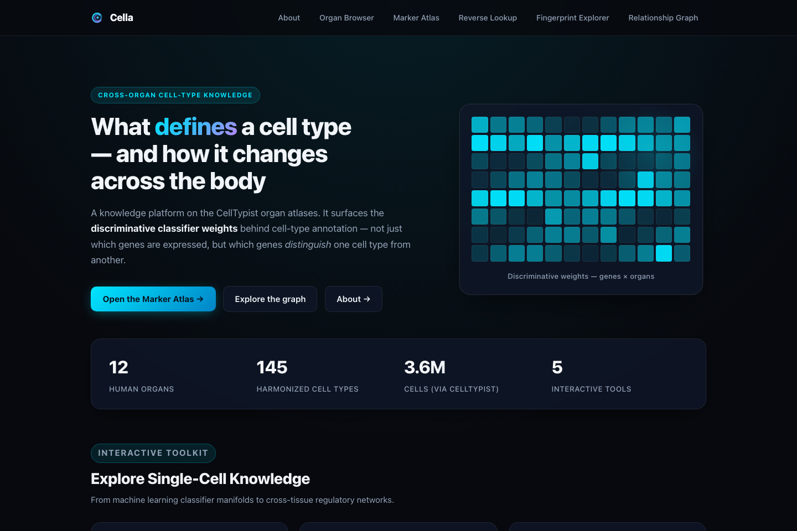
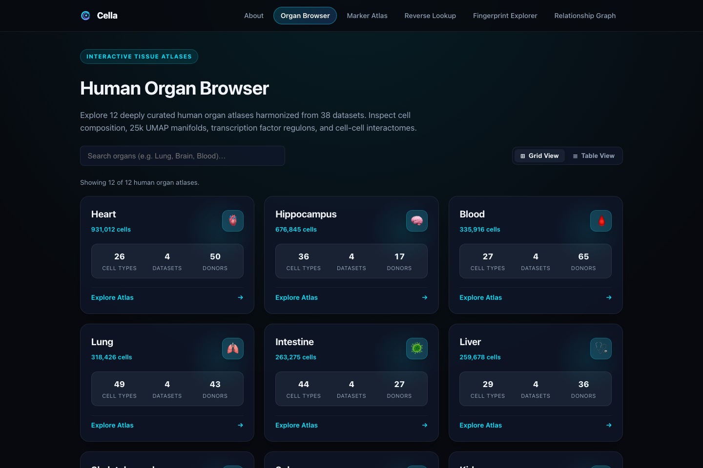
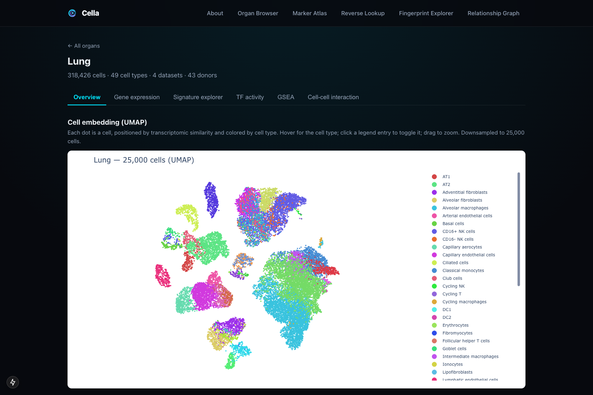
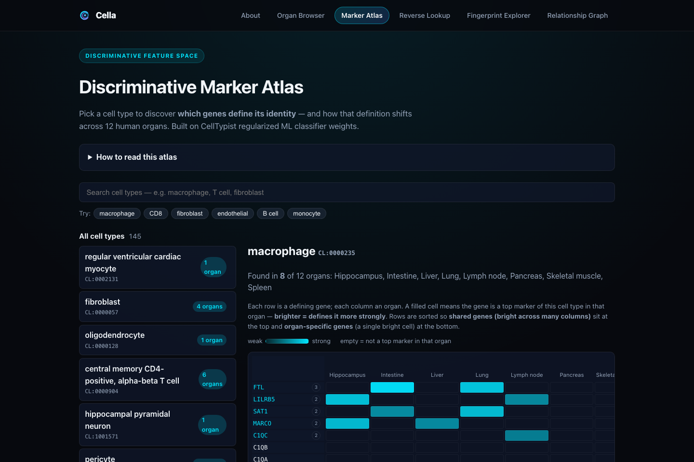
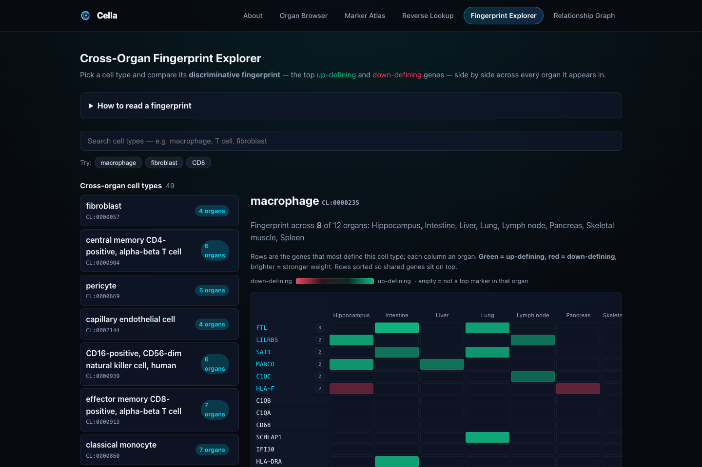
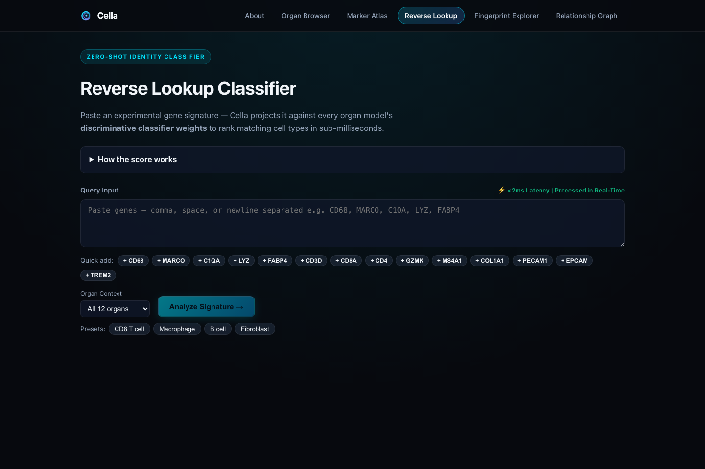
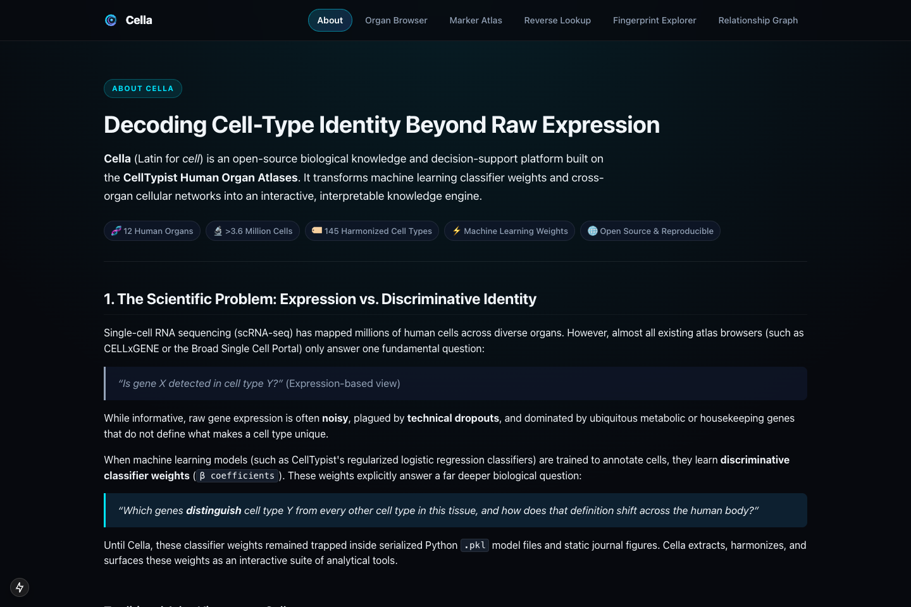

# Cella: Decoding Cell-Type Identity Beyond Raw Expression

[](https://www.python.org/downloads/)
[](https://fastapi.tiangolo.com)
[](https://nextjs.org/)
[](https://github.com/astral-sh/uv)
[](https://opensource.org/licenses/MIT)

> **Cella** (Latin for *cell*) is an open-source biological knowledge and decision-support platform built on top of the **CellTypist Human Organ Atlases**. It surfaces the **learned discriminative classifier weights** and the **cross-organ cell-type relationship graph** — fundamental assets that no traditional single-cell atlas browser exposes interactively.

<p align="center">
  
</p>

---

## 🔬 Scientific Motivation: Expression vs. Discriminative Identity

Most existing single-cell browsers (e.g., CELLxGENE, Broad Single Cell Portal, Human Cell Atlas Portal) answer:
> *"Is gene X expressed in cell type Y?"* (Expression-based view)

However, raw gene expression is often **noisy**, subject to **technical dropouts**, and dominated by ubiquitous housekeeping or metabolic genes.

When machine learning models (such as CellTypist’s regularized logistic regression classifiers) are trained across organs, their **discriminative classifier weights ($\beta$ coefficients)** answer a deeper biological question:
> *"Which genes **distinguish** cell type Y from every other cell type in this tissue, and how does that definition change across organs?"*

```
┌─────────────────────────────────────────────────────────────────────────────────────────────┐
│                                   THE CORE REFRAME                                          │
│                                                                                             │
│  Existing Tools:  "Where is Gene X expressed?"  (Expression-based: noisy, univariate)       │
│  Cella:           "What DEFINES Cell Type Y?"   (ML Discriminative Weights: multivariate)   │
└─────────────────────────────────────────────────────────────────────────────────────────────┘
```

### Key Methodological Framework
1. **Universal Core Identity**: Consensus genes with strong positive weights ($\beta > 0$) across *every* organ where the cell type resides (e.g., canonical lineage master regulators like *CD3D/E* for T cells, *CD19/MS4A1* for B cells).
2. **Tissue-Adapted Identity**: Discriminative genes that are uniquely elevated in a specific organ microenvironment (e.g., *MARCO* in lung alveolar macrophages vs. *C1QA/B* in brain microglia vs. *TREM2* in liver Kupffer cells).

---

## 🏛️ Platform Feature Matrix

| Feature / Dimension | Traditional Portals (CELLxGENE, HCA) | Cella Platform |
|---|---|---|
| **Primary Data Asset** | Raw / normalized expression matrices ($X$) | Learned discriminative weight matrices ($W$) + Cell Ontology graph |
| **Marker Identification** | Heuristic differential expression or curated lists | Regularized logistic regression classifier coefficients |
| **Cross-Organ Comparison** | Manual inspection of disjoint datasets | Automated split into *Universal Core* vs. *Tissue-Adapted* markers |
| **Reverse Querying** | Basic gene lookup across tables | Zero-shot signature scoring against multi-organ ML weight vectors in $<2\text{ ms}$ |
| **Cross-Tissue Lineages** | Single-tissue 2D UMAPs or static dendrograms | Interactive 145-node cross-organ cosine-similarity relationship graph |
| **Multi-Omics Context** | Raw gene counts only | Transcription factor activity (CollecTRI/ULM), GSEA pathways, and cell interactomes (LIANA) |

---

## 🛠️ The 5 Interactive Tools

### 1. 🏛️ Organ Browser (`/organs` & `/organs/[slug]`)
Overview of the 12 human organs (Blood, Bone marrow, Heart, Hippocampus, Intestine, Kidney, Liver, Lung, Lymph node, Pancreas, Skeletal muscle, Spleen) with 25k UMAP embeddings, cell composition, TF activity, and cell-cell interactomes.

<p align="center">
  
</p>

<p align="center">
  
</p>

### 2. 🎯 Discriminative Marker Atlas (`/marker-atlas`)
Search any cell type to inspect its universal core defining genes versus tissue-adapted markers.

<p align="center">
  
</p>

### 3. 🔍 Fingerprint Explorer (`/fingerprint`)
Side-by-side heatmaps of signed positive/negative classifier weights across organs.

<p align="center">
  
</p>

### 4. ⚡ Reverse Lookup (`/reverse-lookup`)
Paste experimental gene signatures to score them against all organ models, identify candidate cell types, and detect novel/uncharacterized states in $<2\text{ ms}$.

<p align="center">
  
</p>

### 5. 📖 About & Research Overview (`/about`)
Methodological rationale, consensus metric formulations, and full-stack systems engineering overview.

<p align="center">
  
</p>

---

## 🚀 Quickstart & Reproducibility Guide

### Prerequisites
- **Python**: 3.11+
- **[uv](https://docs.astral.sh/uv/)**: Fast Python package installer and resolver
- **Node.js**: v18+ or v20+
- **npm** (or `pnpm` / `yarn`)

---

### Step 1: Clone & Configure

```bash
# Clone the repository
git clone https://github.com/YOUR_USERNAME/cella.git
cd cella

# Create runtime configuration
cp .env.example .env

# Install all Python dependencies via uv
uv sync --all-groups
```

---

### Step 2: Run Locally (Instant Launch)

The repository comes with precomputed Parquet artifacts in `data/processed/`, allowing you to run the web platform immediately without heavy data processing:

#### 1. Start the FastAPI Backend:
```bash
# From the project root
uv run --group api uvicorn cella.api.main:app --port 8137 --reload
```
- **API Base URL**: [http://localhost:8137](http://localhost:8137)
- **Interactive Swagger Docs**: [http://localhost:8137/docs](http://localhost:8137/docs)
- **Health Check**: [http://localhost:8137/health](http://localhost:8137/health)

#### 2. Start the Next.js Frontend:
```bash
# In a new terminal window
cd web
npm install
npm run dev
```
- **Web App URL**: [http://localhost:3000](http://localhost:3000)
- **About Page**: [http://localhost:3000/about](http://localhost:3000/about)

---

### Step 3: (Optional) Full End-to-End Pipeline Reproduction

If you wish to re-fetch raw CellTypist resources and recompute all artifacts from scratch:

```bash
# 1. Inspect resolved configuration and organs in scope
uv run cella info

# 2. Acquire raw models and cell metadata (.obs) from Sanger buckets
#    Uses HTTP range requests to stream .obs metadata without downloading 30+ GBs
uv run cella acquire all

# 3. Harmonize cell types and emit weight matrices & top-N markers
uv run cella build

# 4. Derive pseudobulk expression, UMAP embeddings, TF activity, GSEA, and CCI interactomes
uv run cella derive

# 5. Recompute the cross-tissue relationship graph
uv run cella graph
```

---

## 🧪 Testing & Code Quality

```bash
# Run unit & API test suite
uv run pytest

# Lint codebase with Ruff
uv run ruff check .

# Static type checking with Mypy
uv run mypy
```

---

## 📂 Repository Layout

```
cella/
├── data/
│   ├── raw/                 # Downloaded models (.pkl) & cached cell metadata (.obs parquet)
│   └── processed/           # Emitted query-ready Parquet artifacts (registry, weights, markers, etc.)
├── docs/
│   ├── CONCEPT.md           # Full technical architecture and data model
│   └── PLAN.md              # Original project vision and scope
├── src/cella/
│   ├── api/                 # Online FastAPI backend
│   │   ├── routers/         # Endpoint routers (organs, markers, fingerprints, graph, reverse_lookup)
│   │   ├── data.py          # In-memory Parquet data caching layer
│   │   ├── plots.py         # Authoritative Plotly figure builders
│   │   └── main.py          # App entrypoint with GZip and ETag cache middleware
│   ├── core/                # Central Pydantic settings and organ constants
│   └── pipeline/            # Offline data processing pipeline
│       ├── acquire.py       # Remote HDF5 HTTP range-request acquisition
│       ├── extract.py       # Model coefficient and metadata extraction
│       ├── harmonize.py     # Cell Ontology (CL) harmonization
│       ├── derive.py        # TF activity, GSEA, and CCI derivations
│       ├── graph.py         # Cross-tissue cosine-similarity graph construction
│       └── emit.py          # Emits final Parquet artifacts
├── web/                     # Next.js 15 (App Router, React 19, TypeScript) frontend
│   ├── app/                 # Routes (/about, /organs, /marker-atlas, /fingerprint, /graph, /reverse-lookup)
│   ├── app/components/      # 60 FPS HTML5 Canvas UMAP plot, Donut, StackedBar, Nav
│   └── lib/                 # Typed client API with in-memory request caching
├── tests/                   # Pytest test suite
├── pyproject.toml           # Python project definition & dependency groups
└── README.md                # Project documentation
```

---

## 🌐 100% Free Deployment Guide

### Deploy Backend (FastAPI) on Render / Hugging Face Spaces:
- **Render**: Connect your GitHub repository, select `Python 3`, build command `pip install uv && uv sync --group api`, start command `uv run uvicorn cella.api.main:app --host 0.0.0.0 --port $PORT`.
- **Hugging Face Spaces**: Create a Docker Space with the provided `Dockerfile`.

### Deploy Frontend (Next.js) on Vercel:
1. Import repository on [Vercel](https://vercel.com).
2. Set **Root Directory** to `web`.
3. Set Environment Variable: `API_BASE=https://your-backend-url.onrender.com`.
4. Click **Deploy**.

---

## 👤 Author & Research Profile

**Md. Jubayer Hossain**  
Founder & CEO, DeepBio · Multi-Omics Scientist  
- Research Focus: Computational Biology, Single-Cell Transcriptomics, Interpretable Machine Learning, and Multi-Omics Data Systems.

---

## 📚 Citations & References

- **CellTypist Organ Atlases**: Domínguez Conde, C., Xu, C., et al. (2022). *Cross-tissue immune cell analysis reveals tissue-specific features in humans.* **Science**, 376(6594), eabl5197. [doi:10.1126/science.abl5197](https://doi.org/10.1126/science.abl5197)
- **CellTypist v2**: Xu, C., et al. (2024). *CellTypist 2.0: A comprehensive reference atlas for automated cell-type annotation across human organs.* [celltypist.org](https://www.celltypist.org)
- **Cell Ontology (CL)**: Diehl, A. D., et al. (2016). *The Cell Ontology 2016: enhanced content, modularization, and ontology interoperability.* **J Biomed Semantics**, 7(1), 44.

---

## 📄 License

This project is licensed under the MIT License — see the [LICENSE](LICENSE) file for details.
