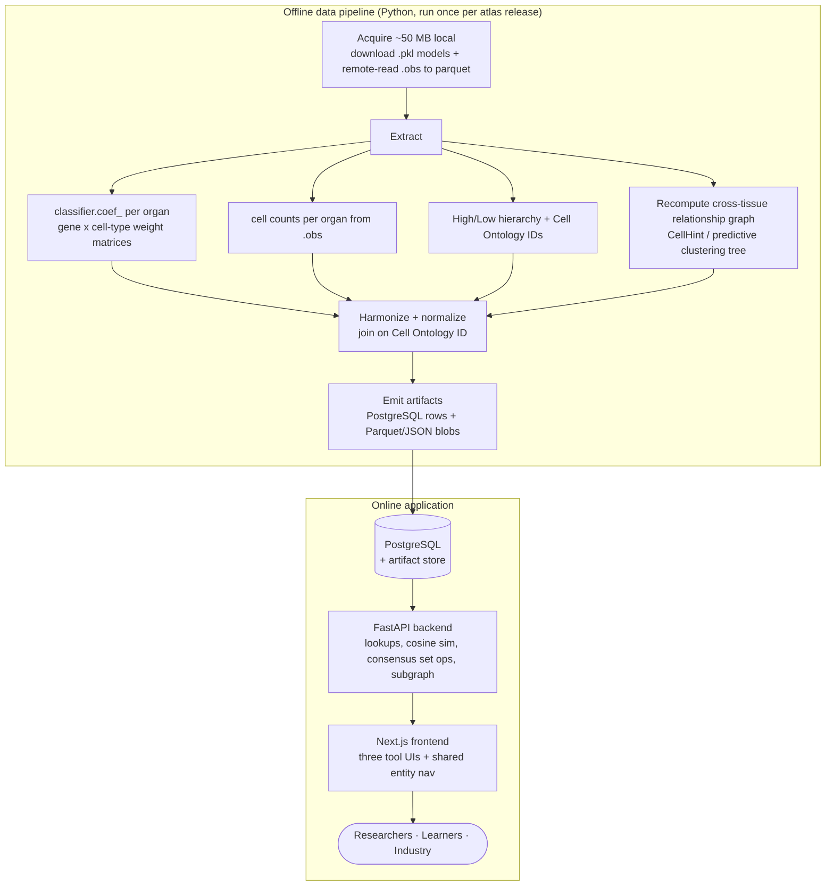
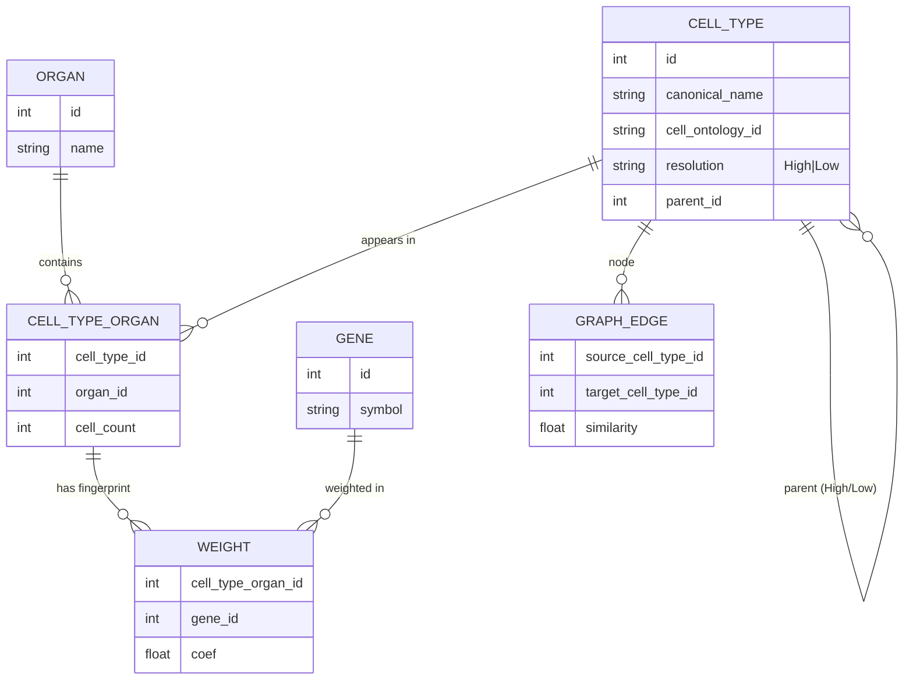

# CellTypist Organs — Project Concept (v1)

> This document turns `docs/PLAN.md` into a concrete, buildable conceptualization:
> what we build first, how the pieces fit, the data pipeline, the data model, and a
> phased delivery plan. It is the bridge between the vision and the code.

---

## 1. One-line definition

An open-source **knowledge and decision-support platform** that exposes the *hidden,
underexploited* assets of the CellTypist Organ Atlases — the **classifier weights** and
the **cross-organ cell-type relationship graph** — as interactive web tools that answer
questions no existing atlas browser answers.

It is explicitly **not** another single-cell database and **not** another UMAP viewer.

The core reframe: existing tools answer *"is gene X expressed in cell type Y?"*. This
platform answers *"what **defines** cell type Y, and how does that definition change
across organs?"* — using learned discriminative weights, not expression.

---

## 2. What is genuinely unique here (the asset)

Everything in v1 is built on assets that already exist inside the official CellTypist
resources but that **no web tool currently surfaces interactively**:

| Asset | Where it lives | What it enables |
|---|---|---|
| Logistic-regression **classifier weights** (`classifier.coef_`) | The `.pkl` models — one weight per gene per cell type | Discriminative fingerprints, "what defines a cell type" |
| **Hierarchical resolution** (High / Low) | Model metadata | Zoom between broad classes and fine subtypes |
| **Cross-tissue relationship graph** | CellTypist v2.0 predictive-clustering-tree output | How ~250 cell types across 12 organs relate |
| **Cell Ontology IDs** | Atlas metadata | Cross-organ harmonization; the join key |
| **Cell counts per organ** | `.h5ad` `.obs` | Tissue-specificity scoring, node sizing |

**Scale:** 12 human organs (Blood, Bone marrow, Heart, Hippocampus, Intestine, Kidney,
Liver, Lung, Lymph node, Pancreas, Skeletal muscle, Spleen), 38 datasets, >3.6M cells,
~250 harmonized cell types.

**Data policy for v1:** official CellTypist resources only (Organ Atlas `.h5ad`,
pretrained `.pkl` models, official metadata). No additional atlases.

---

## 3. v1 scope — three tools, one backbone

v1 ships three tools. They share one underexploited asset (classifier weights plus the
relationship graph), serve all three audiences (researchers, learners, industry), and are
all feasible as precompute-once / serve-interactively web apps.

| Tool | Question it answers | Runtime cost | Build risk |
|---|---|---|---|
| **Discriminative Marker Atlas** | "What genes define this cell type — universal vs. tissue-adapted?" | Low | Low |
| **Cross-Organ Fingerprint Explorer** | "How does the same cell type differ across organs?" | Low | Low |
| **Relationship Graph Explorer** | "How do all ~250 cell types across 12 organs relate?" | Low | **High** (graph recompute) |

### Why these three
The Marker Atlas and the Fingerprint Explorer are two views of the **same coefficient
matrices** — building the weight-extraction pipeline once yields both. The Graph Explorer
needs an additional (and riskier) graph recompute but reuses the same cell-type / ontology
entity model. So one shared backbone pays for all three.

### What v1 leaves out
An identity quiz / learning mode, a tissue-specificity score explorer, a "paste your
markers — is this cell type novel?" query, a cross-organ composition comparator, and a
target-to-cell-type mapper. These are real ideas from the plan but out of scope for v1.
The tissue-specificity score and the marker-novelty query are the cheapest extensions of
the same backbone and are the natural v1.1 candidates.

---

## 4. Architecture

Two clean halves: an **offline pipeline** that turns raw CellTypist resources into
precomputed, query-ready artifacts, and an **online app** that serves them interactively.
Nearly all heavy work happens offline; runtime compute is light (lookups, cosine
similarity, set operations).

**Design principle — precompute over runtime compute.** The `.pkl` weights and the graph
are static per atlas release. We extract and normalize them once, store query-ready
artifacts, and the app becomes a thin interactive layer. This keeps the app cheap to host
(mostly static + a light API) and fast for users.

---

## 5. Data pipeline (offline)

The pipeline is the heart of v1 — the tools are visualization layers on its output.

1. **Acquire (minimal local footprint, ~50 MB total)** — two tiny inputs per organ, no
   bulk data. (a) Download the 12 `.pkl` models (~2 MB each) via a scripted, versioned,
   checksummed fetch. (b) The `.h5ad` atlases are **1–3 GB each but never downloaded
   whole** — no v1 tool touches the expression matrix, only `.obs`. Since `.h5ad` is HDF5
   and the Sanger bucket honors HTTP Range requests, we read *only* the `.obs` group
   remotely (~125 MB of range reads vs a 1.6 GB file, via `fsspec` + `h5py`) and cache it
   as a small local parquet. After the first run everything is local and the pipeline
   never needs the network again. A `manifest.json` records url/bytes/sha256 per file and
   the atlas release stamp.
2. **Extract weights** — for each organ model, load with the CellTypist `Model` API and
   pull `classifier.coef_` (cell type × gene weight matrix) plus the gene vocabulary and
   cell-type labels. `extract_top_markers()` gives the ranked positive markers per type.
3. **Extract metadata** — from each cached `.obs` parquet: cell counts per cell type per
   organ, the multiple label granularities (`Curated_annotation`, `CellHint_harmonised_group`,
   `cell_type`) that carry the High/Low hierarchy, and dataset provenance. Note: model
   labels (e.g. 49 for Lung) and the `.obs` `cell_type` ontology labels (e.g. 43) do not
   line up 1:1 — reconciling them is the harmonization step below.
4. **Harmonize** — the **Cell Ontology ID is the cross-organ join key**. Chain of joins
   (all verified on the real data): model labels = `obs["Curated_annotation"]` **exactly**
   (399/399 across 12 organs); `Curated_annotation` → `obs["cell_type"]` gives the Cell
   Ontology label; and the label → `CL:` ID is recovered with `cellxgene-ontology-guide`
   (exact → synonym → override, **145/145** unique labels mapped). So "macrophage" in Lung
   and Liver collapse to one entity (`CL:0000235`); organ-specific curated labels are kept
   as aliases. 399 organ-level types → 145 ontology-harmonized cross-organ types.
5. **Recompute the relationship graph (highest risk)** — the CellTypist v2.0 graph lives
   in a paper, not as a downloadable artifact. Reproduce it with the CellHint /
   predictive-clustering-tree approach on the harmonized labels to emit nodes + weighted
   edges. **Mitigation:** if faithful reproduction proves hard, fall back to a
   transcriptomic-similarity graph (distance between cell-type weight vectors or mean
   profiles) as a documented v1 approximation, and ship the other two tools independently.
6. **Derive** — consensus vs. tissue-specific marker sets (set operations across organs,
   for the Marker Atlas); per-organ fingerprint vectors (for the Fingerprint Explorer);
   optional tissue-specificity score (entropy/Gini — seeds a v1.1 tool).
7. **Emit** — normalized metadata into PostgreSQL; large numeric matrices into
   Parquet/columnar blobs referenced by the DB. All artifacts versioned by atlas release.

**Reproducibility:** the whole pipeline is a deterministic, re-runnable script (checksums,
pinned deps, release stamps) so a new CellTypist release regenerates every artifact.

---

## 6. Conceptual data model

The unifying entities are the **harmonized cell type** (keyed by Cell Ontology ID) and the
**gene**. Everything else hangs off those.

- **`WEIGHT`** is the largest table (organ × cell type × gene). Store full matrices as
  Parquet for fingerprint/consensus math; keep the top-N discriminative genes per
  `(cell_type, organ)` in PostgreSQL for fast lookups and search.
- **`GRAPH_EDGE`** is precomputed once; the API serves filtered subgraphs.
- **Cell Ontology ID** on `CELL_TYPE` is the join that makes cross-organ comparison possible.

---

## 7. The three tools, concretely

### Discriminative Marker Atlas ("what defines a cell type") — build first
- **Input:** a cell type. **Output:** (a) top discriminative genes per organ, (b) a
  **consensus** set discriminative in *every* organ where the type appears (universal core
  identity), (c) **organ-specific** discriminative genes (tissue-adapted identity).
- **Why first:** pure lookups + set operations on the weight tables — it validates the
  entire extraction/harmonization pipeline with the least UI complexity.
- **Novelty:** distinguishes *universal identity genes* from *tissue-adapted identity
  genes* with one consistent ML framework across 12 organs — not literature curation.

### Cross-Organ Fingerprint Explorer
- **Input:** a cell type. **Output:** for each organ it appears in, the top positive and
  negative classifier weights (the genes that most distinguish it *there*). Side-by-side
  heatmap / radar comparison; click a gene to see its weight across all organs.
- **Reuses:** the same `WEIGHT` matrices as the Marker Atlas — mostly a richer
  visualization layer.
- **Novelty:** answers "is this gene *what defines* the cell type here", not "is it expressed".

### Relationship Graph Explorer — build last (highest risk)
- **Input/interaction:** a navigable graph of ~250 cell types across 12 organs. Nodes sized
  by cell count, colored by organ/lineage; edges = transcriptomic similarity / shared
  subtypes. Zoom High↔Low resolution, filter by organ, search a type, click an edge to see
  what two types share.
- **Depends on:** the graph recompute (§5.5) — the one place that needs real offline
  compute and carries reproduction risk. Rendered with a graph lib (Cytoscape.js / D3 / vis.js).

---

## 8. Technology stack

Aligned with the roles named in `PLAN.md`; nothing exotic.

| Layer | Choice | Rationale |
|---|---|---|
| Offline pipeline | **Python** — Scanpy, AnnData, CellTypist, CellHint | Native to the atlas format and the model API |
| Artifact store | **PostgreSQL** + **Parquet** blobs | Relational metadata + columnar numeric matrices |
| Backend API | **FastAPI** | Light runtime compute (cosine sim, set ops, subgraph); Python shares pipeline code |
| Frontend | **Next.js** (React/TypeScript) | Interactive tool UIs, shared entity navigation |
| Visualization | Heatmap/radar libs (Marker Atlas, Fingerprint); **Cytoscape.js / D3** (Graph) | Fit each tool's interaction model |
| Packaging | Open-source repo, reproducible pipeline, containerized deploy | Production-quality, reproducible |

---

## 9. Phased delivery

Ordered by value-per-risk: prove the backbone, ship the cheap high-value tools, then take
on the risky graph last so it can't block the rest.

| Phase | Deliverable | Exit criterion |
|---|---|---|
| **P0 — Acquisition** | Scripted, versioned download of all 12 `.h5ad` + `.pkl`; checksums | All resources fetched and verified locally |
| **P1 — Backbone** | Weight/metadata extraction, ontology harmonization, data model, API skeleton | Can query any cell type's per-organ weights end-to-end |
| **P2 — Marker Atlas** | Consensus vs. tissue-specific marker views | Pipeline validated through a shipped UI |
| **P3 — Fingerprint Explorer** | Cross-organ heatmap/radar + gene drill-down | Fingerprints compared side-by-side |
| **P4 — Graph Explorer** | Graph recompute + interactive explorer (or documented similarity fallback) | Navigable ~250-node cross-organ graph |
| **P5 — Polish** | Export, docs, shared nav, deploy | Public, reproducible, open-source release |

**Critical-path insight:** P1 (extraction + harmonization) unblocks *all three* tools. It
is the single most important phase; invest there first. The graph recompute is the only
true research risk — isolated to P4 so it can slip or fall back without blocking release.

---

## 10. Risks & mitigations

| Risk | Impact | Mitigation |
|---|---|---|
| v2.0 relationship graph not directly downloadable | Blocks Graph Explorer | Recompute via CellHint; documented similarity-graph fallback |
| Cell Ontology IDs missing for some cell types | Weakens cross-organ join | ~~Risk~~ **Resolved:** obs stores no `CL:` IDs, but `cellxgene-ontology-guide` maps all 145 labels (exact→synonym→override, 145/145) |
| Gene vocabularies differ across organ models | Complicates fingerprint comparison | Normalize to a shared gene space; show coverage explicitly |
| Weight tables large / slow | Sluggish queries | Precompute top-N in PostgreSQL; full matrices in Parquet, loaded on demand |
| Overclaiming biological meaning of weights | Scientific credibility | Frame as *discriminative*, not causal/expression; clear methods notes in-app |

---

## 11. Guardrails (non-goals for v1)

- Not a UMAP/expression browser (CELLxGENE, UCSC Cell Browser already do this).
- No data upload or full annotation service (that's CellTypist/popV; a *lightweight*
  paste-markers version is deferred to a later release).
- No atlases beyond the official 12 CellTypist organs.
- No claims of clinical/safety decisions from classifier weights.

---

## 12. Immediate next step

Begin **P0**: stand up the scripted, versioned acquisition of the 12 organ `.h5ad` atlases
and `.pkl` models, then prototype weight extraction on a single organ (e.g. Lung) to
confirm the `classifier.coef_` → harmonized-fingerprint path end-to-end before scaling to
all 12.
